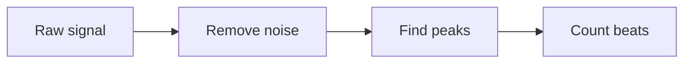

# Explainer

Write for a technically literate reader, such as an engineer or researcher,
who wants to understand quickly. They know the field basics but lose focus on
long, dense, or overstructured text. Aim for a clear technical explanation, not
a beginner lesson.

## Step 1: Pick the case

Read only the one case file that matches the request. Do not load the others.

| The user asked to... | Case file |
|---|---|
| Run a benchmark, simulation, or test and report | `references/cases/test-results.md` |
| Analyze something | `references/cases/analysis.md` |
| Investigate an issue or bug | `references/cases/investigation.md` |
| Understand a paper, method, equation, or research concept | `references/cases/paper-method.md` |
| Analyze and propose a solution | `references/cases/proposal.md` |
| Explain why or how something happens | `references/cases/explanation.md` |
| Anything that fits none of the above | `references/cases/general.md` |

If two cases fit, pick the one that matches the final deliverable. For
example, "investigate and propose a fix" uses `proposal.md`.

## Step 2: Write in this shape

- The first sentence or two give the answer. They carry no label.
- The case file lists what to cover, in order. Each item becomes a short
  paragraph of two to four sentences. Paragraph breaks do the structuring.
- Lists appear only where the case file marks an item as a list, and tables
  only where it marks a table.
- Chat answers have no headings. Saved reports use only the headings the case
  file names.
- Use correct technical terms. Add a short definition only for a term an
  engineer outside this subfield might not know.
- Sentences are direct and concrete. Use a number or a small example instead
  of an abstract description.
- An analogy is optional. Use at most one, inside a paragraph, and only when it
  is accurate and makes an abstract idea easier.
- Describe what happens and why. Code, file paths, and function names appear
  only when the user must act on them.

## Step 3: Add a diagram when it helps

Add a Mermaid diagram for any process with three or more steps, chain of
causes, decision, or before-and-after comparison. Keep it to seven nodes or
fewer, with short labels of two to four words.

## Step 4: Fit the length and place

- **Chat explanation:** about 300 words or fewer, not counting diagrams and
  tables.
- **Saved report:** only when the user asks for a report or file. Save it
  under `docs/reports/`. Start with a title, then the date and time. Aim for
  one page.
- **Technical deep dive:** only when the user explicitly asks for a technical
  or code-level report. Then add a final "How the code works" part that walks
  one example through each step.

## Step 5: Check before sending

- Every number comes from an actual run, file, or cited source. Anything not
  measured or not checked is labeled "not tested" or "unknown".
- A reader who stops after the first paragraph still gets the main answer.
- Nothing is padding. Drop optional items that have nothing real to say.
